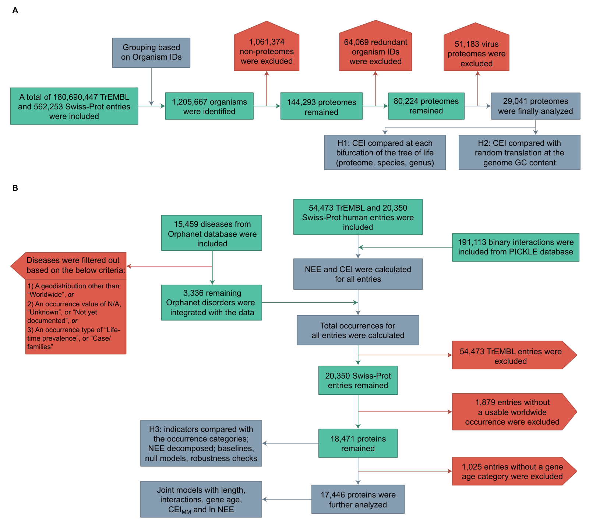
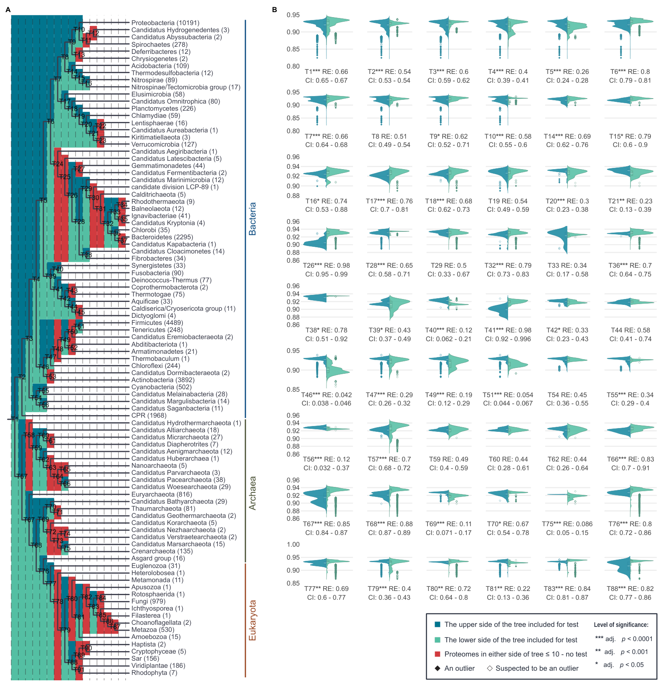
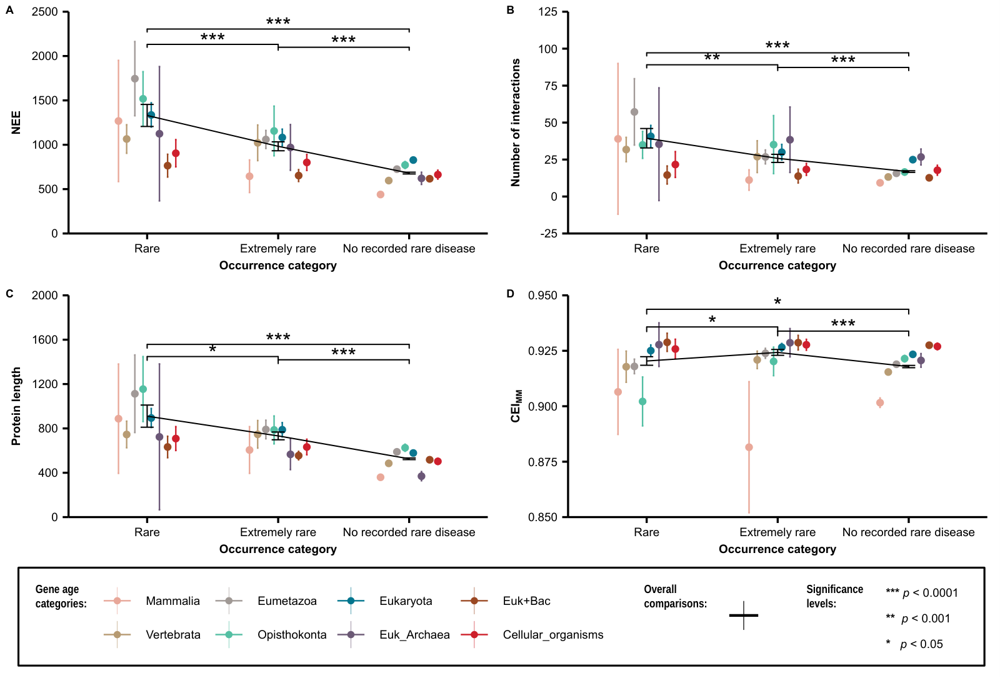

ShannoProt
=====================================
**Amino-acid evenness across the tree of life and protein correlates of rare human disease**

[](LICENSE)

[Reproducibility](#usage) |
[Tutorial on toy data](#toy-data) |
[Reference article](#reference-article) |
[Supplementary materials](Supplementary_materials) |
[Figures](Figures)


# Description
<p align="justify">How evenly do organisms use the amino-acid alphabet? This repository holds the Python and R code and the data tables of the article <i>Amino-Acid Evenness Across the Tree of Life and Protein Correlates of Rare Human Disease</i>. The compositional evenness index (CEI), the Shannon entropy of amino-acid composition normalized to its maximum, is computed for about 180 million proteins of 29,041 complete proteomes (UniProt release 2020_02). It is compared between the two clades of each bifurcation of the tree of life, at the level of proteomes, species and genera, and with the CEI expected from random translation at the GC content of each genome. Extended to protein–protein interaction networks as the neighborhood excess entropy (NEE), it is compared with protein length, the number of interactions, gene age and CEI as an indicator of the involvement of 18,471 human proteins in rare genetic disease (Orphanet).</p>

<p align="center">
  
</p>

<p align="justify">CEI and NEE were called CAIR and EMIP in the preprint of this work and in the code of 2020 (<code>runCAIR</code>, <code>runEMIP</code>), whose names are kept. Comments marked "rev 26" indicate code added or changed in 2026 for the article.</p>


# Table of contents
* [Quick links to main codes](#quick-links-to-main-codes)
* [The compositional evenness index (CEI)](#the-compositional-evenness-index-cei)
* [CEI across the tree of life](#cei-across-the-tree-of-life)
* [The neighborhood excess entropy (NEE)](#the-neighborhood-excess-entropy-nee)
* [Human disease indicators](#human-disease-indicators)
* [Usage](#usage)
* [Toy data](#toy-data)


# Quick links to main codes
* **runCAIR** (CEI of all proteomes, Table S1). Python: [runCAIR](ShannoProt/runCAIR)
* **runGC** (CEI expected under random translation at the genome GC content). Python: [runGC](ShannoProt/runGC)
* **CEI comparisons** (bifurcation tests and figures of the tree of life). R: [CAIR_comparisons](R_codes/CAIR_comparisons)
* **runEMIP** (NEE and disease indicators of the human proteins). Python: [runEMIP](ShannoProt/runEMIP)
* **runNEE** (NEE decomposition, null models, study-bias covariates and statistics of the human analysis). Python: [runNEE](ShannoProt/runNEE)
* **Disease analyses** (figures of the human proteins). R: [EMIP_analyses](R_codes/EMIP_analyses)
* **runTables** (Supplementary Tables S1–S5). Python: [runTables](ShannoProt/runTables)


# The compositional evenness index (CEI)
<p align="justify">For a protein, or for all proteins of a proteome pooled, CEI is the Shannon entropy of the relative frequencies p<sub>i</sub> of the n amino-acid types observed, in units of the 22-letter proteinogenic alphabet (the twenty standard amino acids, selenocysteine and pyrrolysine):</p>

$$\mathrm{CEI} = -\sum_{i=1}^{n} p_i \log_{22} p_i$$

<p align="justify">CEI is Pielou's evenness on this alphabet: it equals 1 when all 22 amino acids are used equally often. B, Z and J are split between their two possible residues, and X is not counted. For single proteins, the Miller–Madow corrected CEI<sub>MM</sub> = CEI + (m − 1)/(2 L ln 22) is also used, where m is the number of residue types observed and L the length of the protein.</p>


# CEI across the tree of life
<p align="justify"><a href="R_codes/CAIR_comparisons/Bifurcation%20tests/Bifurcation%20tests.R">Bifurcation tests.R</a> compares the CEI of the two clades of each bifurcation of the tree of life with the Brunner–Munzel test, with range-preserving 95% confidence intervals of the relative effect, Benjamini–Hochberg adjustment, Vargha–Delaney effect classes and studentized permutation tests for small clades, at the level of proteomes, species and genera. <a href="R_codes/CAIR_comparisons/CAIR%20comparison%20violin%20plots/Violin%20Plots.R">Violin Plots.R</a> draws these comparisons. The same tests are repeated on the GC-adjusted CEI, the difference between the observed CEI and the CEI expected under random translation at the GC content of the genome (<a href="ShannoProt/runGC">runGC</a>, <a href="R_codes/CAIR_comparisons/GC%20null/CEI%20vs%20GC.R">CEI vs GC.R</a>).</p>
<p align="center">
  
</p>


# The neighborhood excess entropy (NEE)
<p align="justify">For a protein Φ of length L<sub>Φ</sub> with k interaction partners of lengths L<sub>j</sub>, NEE is the total compositional entropy of the pooled neighborhood (Φ together with its partners, of total length L<sub>N</sub>) in excess of the summed entropies of the partners, in base-22 units:</p>

$$\mathrm{NEE} = L_N\,\mathrm{CEI}_N - \sum_{j=1}^{k} L_j\,\mathrm{CEI}_j = L_\Phi\,\mathrm{CEI}_\Phi + L_N\,D_{JS}$$

<p align="justify">where CEI<sub>N</sub> is the CEI of the pooled sequence and D<sub>JS</sub> is the length-weighted Jensen–Shannon divergence among the amino-acid compositions of Φ and its partners.</p>


# Human disease indicators
<p align="justify">The human proteins of UniProt release 2020_02 are grouped by the occurrence of their rare diseases in Orphanet (no recorded rare disease, extremely rare, rare). <a href="ShannoProt/runNEE">runNEE</a> compares NEE, protein length, the number of interactions (PICKLE 2.5), gene age and CEI as indicators: AUC and Kendall's τ<sub>b</sub> with bootstrap intervals, logistic and proportional-odds models, null models of NEE (composition shuffle and degree-preserving rewiring) and study-bias checks with the systematic interactome HuRI and with PubMed counts. <a href="R_codes/EMIP_analyses/Human%20proteome%20analysis/DTK%20test%20%26%20Errorbars.R">DTK test & Errorbars.R</a> draws the indicators by disease category and gene age (Dunnett–Tukey–Kramer test).</p>
<p align="center">
  
</p>


# Usage

## Prerequisites
Python 3 (the article used Python 3.11) with the following packages:
```sh
pip3 install requests biopython numpy pandas import_ipynb scipy scikit-learn statsmodels python-igraph openpyxl
```
R (the article used R 4.6) with the packages brunnermunzel, data.table, DTK, ggplot2, ggpubr, HH, igraph, plotly (with [orca](https://github.com/plotly/orca) for the SVG export of the violin plots), processx, readxl, svglite, tidyverse and Cairo. The scripts install missing packages themselves, except DTK, which is archived on CRAN:
```r
install.packages("https://cran.r-project.org/src/contrib/Archive/DTK/DTK_3.5.tar.gz", repos = NULL, type = "source")
```
Versions used for the article: Python 3.11.18 with NumPy 2.4.6, pandas 3.1.1, Biopython 1.88, SciPy 1.17.1, scikit-learn 1.9.1, statsmodels 0.15.0 and python-igraph 1.0.0; R 4.6.2 with brunnermunzel 2.0, DTK 3.5, ggpubr 1.0.0, HH 3.1-53 and plotly 4.12.1.

## Input files
The tables of 2020 (CEI of all proteomes; disease indicators of all reported diseases and of all human proteins, with the Orphanet occurrences of 2020 and the [consensus gene ages](https://github.com/marcottelab/Gene-Ages)) are in [Supplementary_materials](Supplementary_materials), together with the tables of the article that the R scripts read. The new analyses also use the following public files, which should be placed, unpacked where noted, in the working folder (see below):

| File | Source | Used by |
|---|---|---|
| `uniprot_sprot.dat.gz` (in `uniprot_sprot-only2020_02.tar.gz`) | [UniProt release 2020_02](https://ftp.uniprot.org/pub/databases/uniprot/previous_releases/release-2020_02/knowledgebase/) | runNEE |
| `UniProtNormalizedTabular-default.txt` (in the ZIP file) | [PICKLE 2.5](http://www.pickle.gr/Data/2.5/PICKLE2_5_UniProtNormalizedTabular-default.zip) | runNEE |
| `HuRI.tsv` | [HuRI](https://interactome-atlas.org/data/HuRI.tsv) | runNEE |
| `gene2pubmed.gz` | [NCBI Gene](https://ftp.ncbi.nlm.nih.gov/gene/DATA/gene2pubmed.gz) | runNEE |
| `assembly_summary_refseq.txt`, `assembly_summary_genbank.txt`, `assembly_summary_refseq_historical.txt`, `assembly_summary_genbank_historical.txt` | [NCBI assembly reports](https://ftp.ncbi.nlm.nih.gov/genomes/ASSEMBLY_REPORTS/) | runGC |
| `nodes.dmp`, `merged.dmp` (in `taxdump.tar.gz`) | [NCBI taxonomy](https://ftp.ncbi.nlm.nih.gov/pub/taxonomy/taxdump.tar.gz) | runGC |

The NCBI files are updated continuously; the article used the files of 2026.

## Running the analyses
All steps are run from one working folder inside the repository, for example `Results`, which holds the files above and receives all outputs:
```sh
mkdir Results
cd Results
python ../ShannoProt/runNEE/runNEE.py
python ../ShannoProt/runGC/runGC.py
Rscript "../R_codes/CAIR_comparisons/Bifurcation tests/Bifurcation tests.R"
Rscript "../R_codes/CAIR_comparisons/CAIR comparison violin plots/Violin Plots.R"
Rscript "../R_codes/CAIR_comparisons/GC null/CEI vs GC.R"
Rscript "../R_codes/CAIR_comparisons/Wave of Life/Wave of life.R"
Rscript "../R_codes/EMIP_analyses/Human proteome analysis/DTK test & Errorbars.R"
Rscript "../R_codes/EMIP_analyses/Network visualization/Human proteome networks.R"
python ../ShannoProt/runTables/runTables.py
```
<p align="justify">runNEE takes about one hour. With <code>--cds</code>, runGC also recalculates the null with the GC content of each codon position in one annotated genome per genus (it downloads about 11 GB of coding sequences). The R scripts read the tables they need from Supplementary_materials if they are not in the working folder, so each of them can also be run alone (Violin Plots.R after Bifurcation tests.R).</p>

| Article | Script | Output in the working folder |
|---|---|---|
| Table 2, Tables S2 and S3 | [Bifurcation tests.R](R_codes/CAIR_comparisons/Bifurcation%20tests/Bifurcation%20tests.R) | Bifurcation tests (proteome).csv, (species).csv, (genus).csv, Bifurcation tests summary.csv and the same files of delta CEI |
| Figure 2 | [Violin Plots.R](R_codes/CAIR_comparisons/CAIR%20comparison%20violin%20plots/Violin%20Plots.R) | Fig2B.svg |
| Figure 3 | [runGC.py](ShannoProt/runGC/runGC.py), [CEI vs GC.R](R_codes/CAIR_comparisons/GC%20null/CEI%20vs%20GC.R) | GC null per proteome.csv, GC null summary by domain.csv, GC null summary by phylum.csv, GC null curve.csv, GC null maxima.csv, GC null distribution shape.csv, Fig3.svg |
| Figure 4 | [Wave of life.R](R_codes/CAIR_comparisons/Wave%20of%20Life/Wave%20of%20life.R) | Fig3A.svg … Fig3G.svg (numbered as in the preprint) |
| Tables 3–5, Sections 3.4–3.7 | [runNEE.py](ShannoProt/runNEE/runNEE.py) | NEE decomposition.csv, Study bias covariates.csv, NEE null models.csv, Human indicator statistics.json, Table_S5.csv |
| Figure 5 | [DTK test & Errorbars.R](R_codes/EMIP_analyses/Human%20proteome%20analysis/DTK%20test%20%26%20Errorbars.R) | Fig5_ColouredAges.svg, Fig5_BlackMain.svg |
| Figure 6 | [Human proteome networks.R](R_codes/EMIP_analyses/Network%20visualization/Human%20proteome%20networks.R) | Fig6A.svg … Fig6P.svg |
| Tables S1–S5 | [runTables.py](ShannoProt/runTables/runTables.py) | Supplementary tables/Table_S1.xlsx … Table_S5.xlsx |

<p align="justify">Figures 1 and S1 and the tree of Figure 2A are drawings. The figures of the article are in <a href="Figures">Figures</a>. <a href="R_codes/EMIP_analyses/Human%20proteome%20analysis/Likert%20plots.R">Likert plots.R</a> draws the indicators by rank of disease occurrence (Figure 5 of the preprint).</p>

<p align="justify">The proteome CEI values were computed in 2020 with runCAIR from <code>uniprot_sprot.fasta</code> and <code>uniprot_trembl.fasta</code> of UniProt release 2020_02 (about 100 GB) and the list of non-redundant proteomes; the disease indicators of 2020 with runEMIP from the PICKLE 2.5 file, the human proteome table of UniProt (UP000005640), the Orphanet occurrence file (<code>en_product9_prev</code>) and the consensus gene ages (see the headers of the programs and the toy data below).</p>


# Toy data
<p align="justify">The toy data are small subsets of the real proteome and disease data, so that runCAIR and runEMIP can be tried without large downloads. The program counts all residues of the toy FASTA files, groups them by organism and calculates the CAIR (CEI) of each complete proteome. The files are in the <a href="ShannoProt/ToyData">ToyData folder</a>.</p>

```sh
cd ShannoProt/ToyData/runCAIR
python runCAIR.py
```
```sh
cd ShannoProt/ToyData/runEMIP
python Human_disease_category_indicators.py
```
<p align="justify">For the complete calculations, the same programs are run in <code>ShannoProt/runCAIR</code> and <code>ShannoProt/runEMIP</code> with the full input files. Both can also be run from the notebooks (<code>runCAIR.ipynb</code>, <code>Human_disease_category_indicators.ipynb</code>).</p>


# Reference article
Kamari, F.; Dadmand, S. Amino-Acid Evenness Across the Tree of Life and Protein Correlates of Rare Human Disease. *Biology* (under review).

Preprint: Kamari, F.; Dadmand, S. An Extension of Shannon's Entropy to Explain Taxa Diversity and Human Diseases. *bioRxiv* 2020. https://doi.org/10.1101/2020.08.03.233767


# License
Licensed under the MIT License. See [LICENSE](LICENSE).
